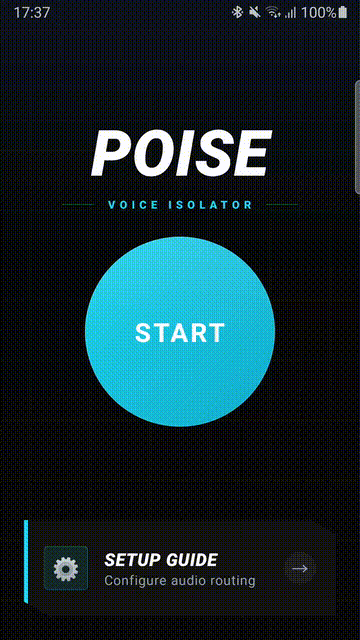

# Poise Android

A high-performance voice isolation app that uses machine learning denoising models to isolate speech in real-time for system-wide Android audio. Works on Android 10 and later, with wired or Bluetooth headphones.



## Features
- **ML Voice Isolation**: Real-time background noise suppression for clear audio.
- **Automatic Audio Routing**: Captures the playing app's audio, mutes the original while Poise runs, and plays the cleaned-up sound to your headphones. The volume keys control Poise's volume.
- **Voice Activity Detection**: Will only run inference and process audio when it detects sound.

> **Note**: The app needs screen-casting permission to capture other apps' audio. Apps that block audio capture (some streaming apps) stay silent while Poise runs.

## Installation

Untill I officially publish on the Play Store, you can install the app from the [GitHub releases](https://github.com/chabandou/poise-android/releases).

## Getting Started

### Prerequisites
- Android SDK & JDK 17+
- Android 10+ device and headphones (wired or Bluetooth)

### Build & Install
```bash
# Build the debug APK
./gradlew assembleDebug

# Install on connected device
adb install -r app/build/outputs/apk/debug/app-debug.apk
```
