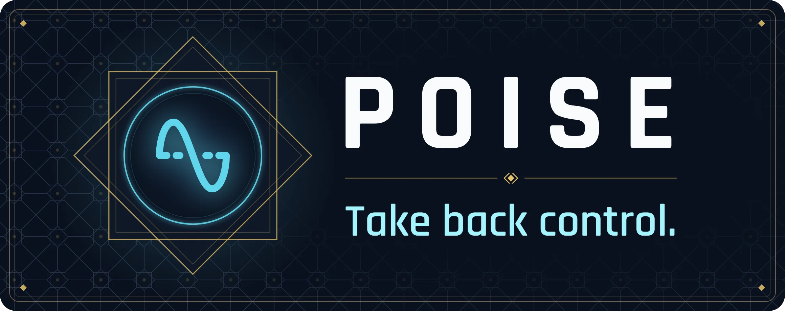
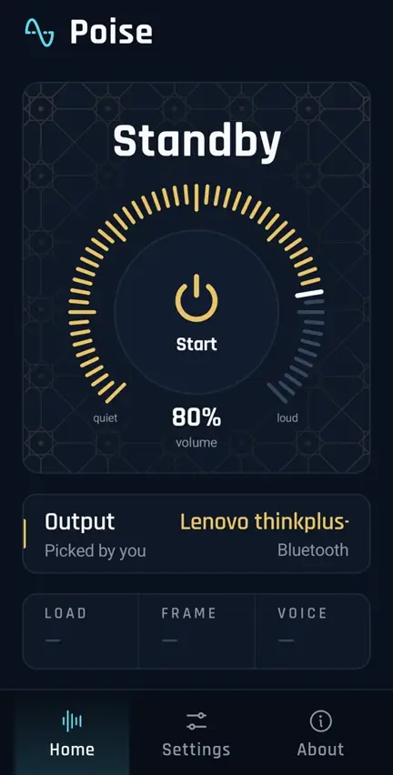
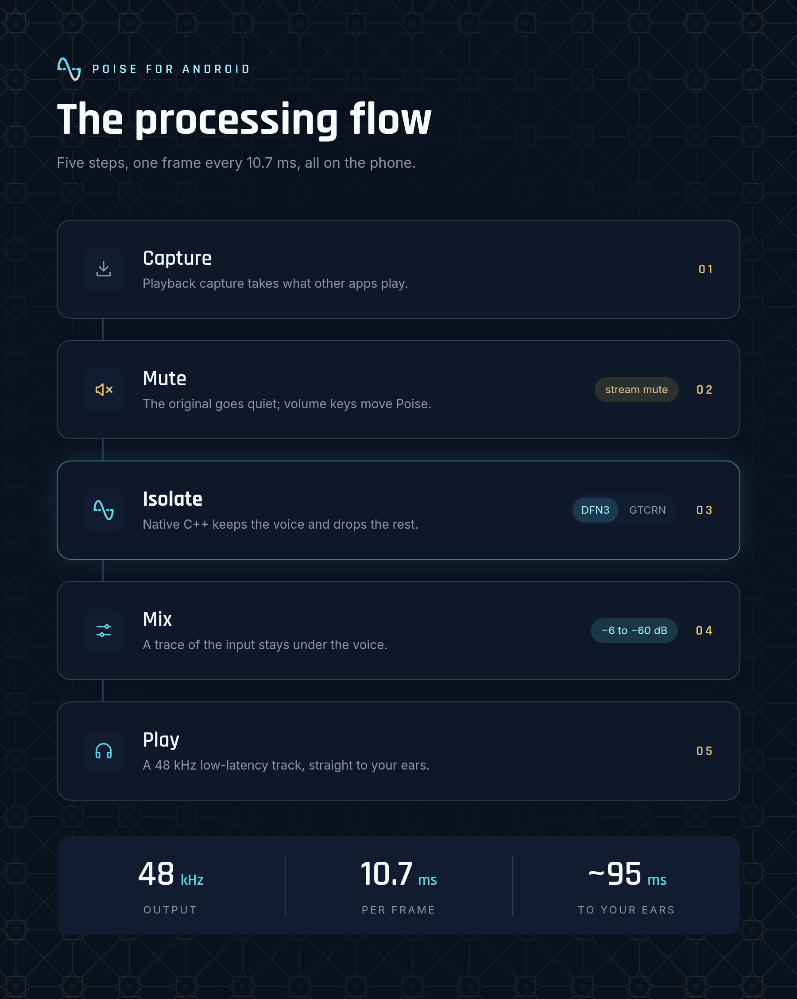

<div align="center">

</div>


<div align="center">

[](https://github.com/chabandou/poise-android/releases/latest)
[](https://github.com/chabandou/poise-voice-isolator)
[](https://github.com/chabandou/poise-voice-isolator)

</div>


<div align="center">

[](https://kotlinlang.org/)
[](app/src/main/cpp)
[](https://github.com/chabandou/poise-android/releases/latest)
[](https://github.com/chabandou/poise-android/commits/main)

</div>


<div align="center">
<picture>
  <source media="(prefers-color-scheme: light)" srcset=".github/media/bismillah_black.png">
  <source media="(prefers-color-scheme: dark)" srcset=".github/media/bismillah.png">
  
</picture>
</div>

<h1 align="center">Poise for Android</h1>

<p align="center">
  <b>Real-time voice isolation for everything your phone plays.</b><br/>
  <sub>Music and noise out, speech in. On-device, open source, no account.</sub>
</p>

<p align="center">
  <a href="https://github.com/chabandou/poise-android/releases/latest"><b>Download</b></a> ·
  <a href="#install">Install</a> ·
  <a href="#models">Models</a> ·
  <a href="#how-it-works">How it works</a> ·
  <a href="#troubleshooting">Troubleshooting</a> ·
  <a href="#development">Development</a>
</p>

<p align="center">
  
</p>

Poise sits between your apps and your headphones. It captures what other apps play (YouTube, podcasts, streams), runs it through a neural speech model on the phone's CPU, and plays back only the voices. Press Start once and leave it running.

- **Strips (or massively reduces) music, keeps speech.** DeepFilterNet3 removes instrumentals and background noise while leaving voices intact. A halal-friendly way to watch and listen to online content.
- **Native, not a runtime.** Both models are hand-written C++ with their weights in the APK: no ONNX Runtime, a ~6 MB download, and ~2–3 ms of work per frame on a budget Snapdragon 685.
- **Short path to your ears.** A 48 kHz low-latency output gets Android's fast mixer: about 95 ms from the app's sound to a wired output.
- **Fits in the system.** Volume keys, a Quick Settings tile, a notification with volume and stop, auto-stop after silence and stop on unplug.
- **Private by construction.** Audio never leaves the phone. The only network request is an optional daily check for a new release on GitHub.

> [!NOTE]
> On Windows and Linux, Poise is a separate desktop app: [poise-voice-isolator](https://github.com/chabandou/poise-voice-isolator).

## Install

Download **`poise-android-v<version>.apk`** from the [latest release](https://github.com/chabandou/poise-android/releases/latest) and open it on the phone. Android asks once to allow installs from your browser or file manager.

Needs **Android 10 or later** on a **64-bit ARM** phone (`arm64-v8a`, nearly every phone since 2017). Works with wired or Bluetooth headphones, or the speaker.

On **Start**, Android asks to share your screen: pick **Entire screen** and confirm. Poise uses that grant only to capture audio; it never records the screen.

> [!TIP]
> In **Settings → Setup**, allow **No battery limits** so a session survives the screen turning off, and add the **Quick tile** to start Poise from the shade. With **Update alerts** on, Poise checks GitHub once a day and notifies you when a new version is out.

> [!IMPORTANT]
> Poise can’t always completely remove music. In certain scenarios some can pass through, especially loud music that’s close to speech. We can’t guarantee that the output audio is permissible, use your own judgement.

## Models

Pick one in **Settings → Model**. It applies from the next start.

| Model | Rate · frame | Engine delay | Load (RTF) | Weights |
|:--|:--:|:--:|:--:|:--:|
| **DeepFilterNet3** *(default)* | 48 kHz · 10.7 ms | 32 ms | ~0.25 | 3.0 MB |
| **GTCRN** | 16 kHz · 16 ms | 16 ms | ~0.12 | 206 KB |

<sub>RTF = processing time ÷ audio time, measured in the app on a realme C67 (Snapdragon 685, Cortex-A73 cores). Below 1.0 keeps up with real time. The <b>Load</b> readout on Home shows the same number live.</sub>

<details>
<summary><b>Model notes</b></summary>

- **DeepFilterNet3** ([`df3.cpp`](app/src/main/cpp/df3.cpp)) is a port of the desktop app's optimized streaming export ([`models/df3.onnx`](models/df3.onnx)). Its five GRUs run in int8 with per-row scales, which cut the weights from 8.9 to 3.1 MB and the APK from 11.2 to 5.6 MB, for an SI-SDR loss of 0.14 dB at 0 dB SNR and none at 5 or 10 dB. Everything before the GRUs matches ONNX Runtime within 1e-4. It runs on every frame, since its recurrent state needs every frame.
- **GTCRN** ([`gtcrn.cpp`](app/src/main/cpp/gtcrn.cpp), [upstream](https://github.com/Xiaobin-Rong/gtcrn)) matches ONNX Runtime within 1e-4 on every tensor. It runs at 16 kHz, so its output stops at ~7.5 kHz, and frames below the silence threshold skip it and are turned down 20 dB. The model itself costs under 0.5 ms per frame on a big core; through ONNX Runtime it took ~8 ms, mostly overhead between its 281 small operators, which is why both models are native.
- Shared building blocks (GRU, convolutions, `f32x4` vector helpers) live in [`nn.h`](app/src/main/cpp/nn.h); the STFT and iSTFT in [`stft.cpp`](app/src/main/cpp/stft.cpp).

</details>

## How it works



1. **Capture.** `AudioPlaybackCapture` records other apps' media, game and unlabeled audio as mono float, at the model's own rate: Android resamples, with proper filtering.
2. **Mute the original.** The media stream gets a *stream mute*, not volume 0, so Bluetooth headphones with absolute volume keep their own level. Volume keys step Poise's volume instead; Android unmutes on volume up, and Poise mutes again within ~30 ms.
3. **Isolate.** The model runs on its own thread at `URGENT_AUDIO` priority, pinned off the phone's slowest CPU cluster.
4. **Mix.** **Reduction strength** sets how far the input stays under the voice, from −6 dB (gentle) to −60 dB (strong).
5. **Play.** A low-latency `AudioTrack` on the *accessibility* usage: it plays at the media volume, but the media mute doesn't silence it. Only a 48 kHz track gets the fast mixer, so GTCRN's 16 kHz output goes through a 96-tap polyphase upsampler. The track's cushion starts at two frames and grows by one per underrun.

| Output | App's sound → your ears |
|:--|:--:|
| Wired or speaker, fast path granted | ~95 ms |
| Wired or speaker, fast path refused | ~130–150 ms |
| Bluetooth | the above, plus the headphones' own link |

<sub>Measured on a realme C67 with DeepFilterNet3. Video players can't be told about this delay, so speech trails the picture slightly.</sub>

<details>
<summary><b>Readouts</b></summary>

| Readout | Meaning |
|:--|:--|
| **Load** | The model's share of each frame (RTF); **Idle** while it's quiet |
| **Frame** | Average processing time per frame |
| **Voice** | **Yes** while sound is above the silence threshold, **Quiet** below it |

</details>

<details>
<summary><b>Permissions</b></summary>

| Permission | Why |
|:--|:--|
| `RECORD_AUDIO` | Playback capture requires it |
| `FOREGROUND_SERVICE` · `FOREGROUND_SERVICE_MEDIA_PROJECTION` | The session runs as a foreground service |
| `POST_NOTIFICATIONS` | The session notification (volume, stop) and update alerts |
| `VIBRATE` | The rising taps as the dial lights up (Android 11+) |
| `REQUEST_IGNORE_BATTERY_OPTIMIZATIONS` | Lets **No battery limits** ask Android; nothing changes until you allow it |
| `INTERNET` · `ACCESS_NETWORK_STATE` · `RECEIVE_BOOT_COMPLETED` | The daily update check: one request for the latest release tag, kept scheduled across restarts |

</details>

## Troubleshooting

<details>
<summary><b>An app stays silent</b></summary>

Apps can opt out of playback capture (some streaming apps do). Poise can't hear them, and their sound stays muted while it runs. Stop Poise to hear them again.

</details>

<details>
<summary><b>The session stops when the screen turns off</b></summary>

Allow **Settings → Setup → No battery limits**. Some phones also have their own battery manager; let Poise run in the background there too.

</details>

<details>
<summary><b>Clicks or dropouts</b></summary>

- Switch to **GTCRN**: about half of DeepFilterNet3's load.
- Watch **Load** on Home; it should stay well below 100%.
- System-wide sound effects on the output (an equalizer or "sound enhancement" from the phone maker) can make Android refuse the fast mixer path, which adds delay. `adb logcat -s AudioPipeline` says `fast path granted` or `refused` at every start.

</details>

<details>
<summary><b>Media stays muted after a crash</b></summary>

Poise records that it muted media, and the next launch unmutes it. Opening the app once is enough.

</details>

## Development

### Build

Needs JDK 17 and the Android SDK (API 34) with the NDK and CMake 3.22.1.

```bash
git clone https://github.com/chabandou/poise-android.git
cd poise-android
./gradlew assembleDebug
adb install -r app/build/outputs/apk/debug/app-debug.apk
```

The native library compiles with `-O2` in debug builds too, since a model that runs every 10.7 ms has to keep up while you debug.

### Dev loop

[`scripts/dev.sh`](scripts/dev.sh) drives a USB-connected phone. `ANDROID_SERIAL` picks one when several are attached.

| Command | Does |
|:--|:--|
| `build` · `install` | Debug APK; install with `-r` |
| `bench` | Release code signed with the debug key, installed over the debug build: what users get |
| `test` | On-device tests (golden output of both models), without wiping the app's settings |
| `start` · `stop` | Start or stop a session, through the consent prompt |
| `play [file]` | Play a tone over noise (or your own file) in Samsung's video player |
| `metrics` · `logs` · `check` | On-screen readouts and the pipeline's health line · live logs · crashes and media volume |
| `smoke` | `install`, `start`, `play`, `metrics`, `stop`, `check` in one go |

> [!WARNING]
> Run on-device tests with `scripts/dev.sh test`, not `./gradlew connectedAndroidTest`: Gradle uninstalls the app afterwards, which erases its settings. Unit tests run on the host with `./gradlew test`.

### Native models

Both ports have a script that writes the weights asset from the `.onnx` and checks the C++ against ONNX Runtime, built for your machine. They need `numpy`, `onnx`, `onnxruntime` and a host C++ compiler; `quality` also needs `soundfile` and `scipy`.

```bash
scripts/native-gtcrn.py export   # app/src/main/assets/gtcrn.weights from models/gtcrn.onnx
scripts/native-gtcrn.py check    # every exposed tensor, 2000 frames, within 1e-4
scripts/native-df3.py export     # df3.weights, int8 GRUs
scripts/native-df3.py check
scripts/native-df3.py quality CLEAN.wav NOISE.wav...   # SI-SDR of int8 vs float at 0, 5, 10 dB SNR
```

The weights file is a little-endian `uint32` count, then each weight's size, then the values in the order the graph first uses them, so the C++ reads them in graph order and checks every size as it goes.

### Releases

Bump `versionCode` and `versionName` in [`app/build.gradle.kts`](app/build.gradle.kts) and tag the release `v<versionName>`: the update check compares that tag with the installed version. Sign every release with the same key, or Android refuses to install it over the last one. `assembleRelease` signs with the key named in `keystore.properties` at the repo root (`storeFile`, `storePassword`, `keyAlias`, `keyPassword`), which git ignores. Without that file the APK comes out unsigned.

### Layout

```
app/src/main/
├── java/com/poise/android/
│   ├── MainActivity.kt          # Permissions, the capture consent, the Compose root
│   ├── audio/
│   │   ├── AudioPipeline.kt     # Capture → model → track loop, cushion, delay and health log
│   │   ├── Denoiser.kt          # The model interface; picks GTCRN or DF3
│   │   ├── DF3Processor.kt      # DeepFilterNet3 (48 kHz) and its dry mix
│   │   ├── GTCRNProcessor.kt    # GTCRN (16 kHz), STFT, silence bypass
│   │   ├── Upsampler.kt         # 16 → 48 kHz polyphase filter
│   │   ├── Outputs.kt           # Output devices for the picker
│   │   └── ProcessingStats.kt   # Load, frame time, voice
│   ├── service/
│   │   ├── AudioCaptureService.kt   # Foreground session: media mute, volume keys, notification, unplug
│   │   ├── PoiseSettings.kt         # Settings on disk, as flows
│   │   ├── AudioServiceState.kt     # Session state shared with the UI
│   │   ├── PoiseTileService.kt      # Quick Settings tile
│   │   └── UpdateCheckService.kt    # Daily GitHub release check
│   └── ui/
│       ├── MainScreen.kt        # Home, Settings, About
│       ├── Dial.kt · Emblem.kt · Picker.kt
│       ├── Haptics.kt           # Haptic feedback, with plain pulses for basic vibrators
│       └── theme/               # Six palettes: Halcyon, Verdant, Vigil, Ember, Eclipse, Orchid
├── cpp/
│   ├── df3.cpp · gtcrn.cpp      # The models
│   ├── nn.h                     # GRU (float and int8), convolutions, vector helpers
│   ├── stft.cpp                 # STFT / iSTFT for GTCRN
│   └── jni_bridge.cpp           # JNI, and pinning the audio thread to fast cores
└── assets/                      # df3.weights, gtcrn.weights

models/                          # Source .onnx files the weights come from
scripts/                         # dev.sh, native-df3.py, native-gtcrn.py
```

## Credits

| | |
|:--|:--|
| [DeepFilterNet3](https://github.com/Rikorose/DeepFilterNet) | Hendrik Schröter (Rikorose) |
| [GTCRN](https://github.com/Xiaobin-Rong/gtcrn) | Xiaobin Rong (MIT; official streaming export) |

## License

[MIT](LICENSE)

## Contributing

There is no formal process yet. Issues, ideas and pull requests are all welcome.

<div align="center">
<br/>

**Made with care by Chabandou**

[Star on GitHub](https://github.com/chabandou/poise-android) · [Report a bug](https://github.com/chabandou/poise-android/issues) · [Request a feature](https://github.com/chabandou/poise-android/issues)

</div>
